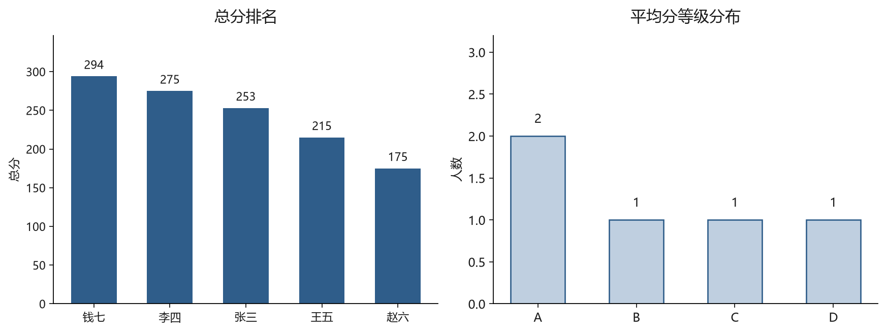

# 成绩统计小工具（grade_stats）

一个用 Python 写的小工具：输入一批学生的各科成绩，自动算出总分、平均分、排名和等级分布。

## 怎么运行

```bash
python grade_stats.py
```

需要 Python 3.8 以上，不需要安装任何第三方库。

## 运行效果

```
==============================================
姓名    各科成绩                总分      平均分
----------------------------------------------
张三    85/90/78            253     84.3
李四    92/88/95            275     91.7
王五    70/65/80            215     71.7
赵六    58/62/55            175     58.3
钱七    100/98/96           294     98.0
==============================================

【排名】
  第 1 名  钱七  总分 294
  第 2 名  李四  总分 275
  ...

【平均分等级分布】
  A 段：2 人  ■■
  B 段：1 人  ■
  ...
```

## 可视化结果



图表用 `make_chart.py` 生成（需要 matplotlib）：

```bash
python make_chart.py
```

它**复用 `grade_stats.py` 里的 `SCORES` 数据和统计函数**，不重复写一遍逻辑——这是模块化的意义：数据只有一份来源。

## 用到的知识

| 知识点 | 用在哪 |
|---|---|
| 字典 dict | `SCORES`：姓名 → 分数列表 |
| 列表 list | 每个学生的多科分数 |
| 元组 tuple | 排名结果里的 `(姓名, 总分)` |
| 字符串 str | 拼接输出、`ljust` 对齐、`format` 保留小数 |
| for 循环 | 遍历学生、遍历分数、冒泡排序 |
| 函数 def | 拆成 `total_of`、`average_of`、`rank_list` 等小函数 |
| 条件判断 | 分数转等级 `A/B/C/D` |

## 设计取舍

- **数据写在文件里**，不接数据库——先跑通再说，避免一开始就卡在环境配置上。
- **排序用手写冒泡**，没用 `sorted()`——目的是练循环和列表操作，不是求最短代码。
- **查询用 input()**，直接回车可跳过——方便自动化测试。

## 可以继续做的

- [ ] 支持从 CSV 文件读数据
- [ ] 把分数段分布画成图（matplotlib）
- [ ] 加一个菜单，支持增删改学生
- [ ] 单元测试
